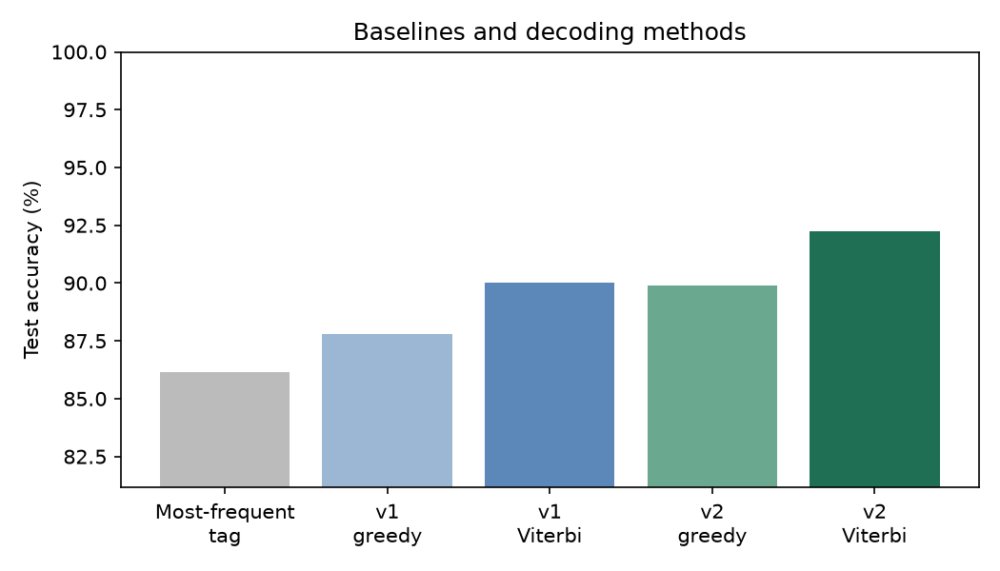
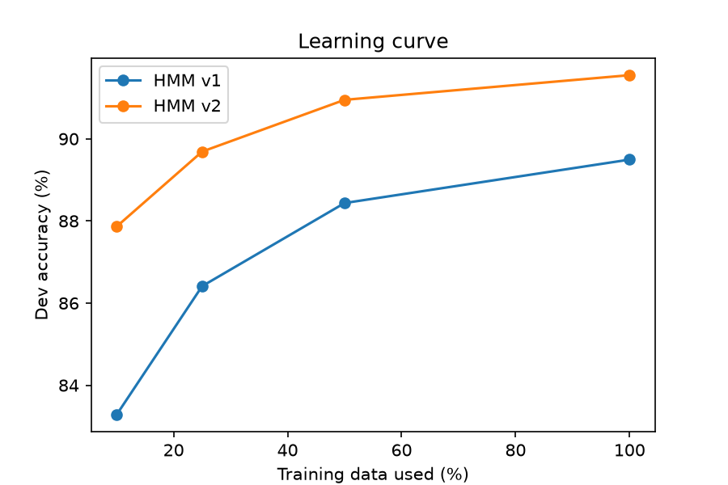

# Baselines and Ablations

This document presents experimental evidence and analysis comparing the HMM POS tagger variants (HMM v1 without word shapes vs. HMM v2 with word shape features) against a baseline and examining the impact of decoding strategies, smoothing parameters, training data scale, and statistical significance.

All experiments were executed via `experiments/ablations.py`, and the complete quantitative results are serialized in `results/ablations.json`.

---

## 1. Most-Frequent-Tag Baseline

The most-frequent-tag (MFT) baseline assigns each word the tag it was most frequently paired with in the training set (case-insensitive). Any token not observed in training falls back to the dataset's overall most frequent tag (`NOUN`). It incorporates no contextual transition information.

| Model / Baseline | Dev Accuracy | Dev Unknown Acc. | Test Accuracy | Test Unknown Acc. |
| :--- | :---: | :---: | :---: | :---: |
| **Most-Frequent-Tag (MFT)** | 86.12% | 29.63% | 86.16% | 28.59% |
| **HMM v1** | 89.49% | 54.27% | 90.03% | 53.51% |
| **HMM v2** | 91.55% | 75.23% | 92.24% | 75.72% |

### Observations & Comparison
- The unigram MFT baseline achieves a respectable test accuracy of **86.16%**, illustrating that English vocabulary exhibits strong lexical bias where most word types have a single dominant POS tag.
- However, the baseline performs poorly on unknown tokens, achieving only **28.59%** accuracy through naive majority-class fallback.
- **HMM v1** gains **+3.87 percentage points** in overall test accuracy and **+24.92 percentage points** on unknown words over the MFT baseline. This demonstrates that sequence transition dynamics ($P(t_i \mid t_{i-1})$) are essential for resolving lexical ambiguity and constraining tag choices for novel words.

---

## 2. Greedy Decoding vs. Viterbi

To isolate the contribution of global sequence optimization, we compare greedy decoding against Viterbi decoding using identical transition ($\log A$) and emission ($\log B$) parameters. Greedy decoding selects the locally optimal tag at each step based only on the immediate prior tag ($\arg\max_{t} [ \log A_{t_{i-1}, t} + \log B_{t, w_i} ]$), without lookahead.

| Model | Decoding Strategy | Dev Accuracy | Dev Unknown Acc. | Test Accuracy | Test Unknown Acc. | Viterbi Gain (Test) |
| :--- | :--- | :---: | :---: | :---: | :---: | :---: |
| **HMM v1** | Greedy | 87.43% | 50.88% | 87.78% | 51.97% | — |
| **HMM v1** | Viterbi | 89.49% | 54.27% | 90.03% | 53.51% | **+2.25 pp** |
| **HMM v2** | Greedy | 89.45% | 72.72% | 89.91% | 73.96% | — |
| **HMM v2** | Viterbi | 91.55% | 75.23% | 92.24% | 75.72% | **+2.33 pp** |

### Why Viterbi Improves Performance
Greedy decoding is vulnerable to garden-path errors: a locally high-scoring tag at token $i$ can lead into a state with zero or near-zero transition probabilities for subsequent words, precipitating error cascades. Viterbi decoding evaluates the joint probability of the full state sequence via dynamic programming, allowing future evidence to correct early ambiguities. Viterbi yields a robust **+2.25 pp to +2.33 pp** boost across both model variants.

A comparison across all decoding variants and baselines is illustrated below:

---

## 3. Smoothing Ablation

Add-$k$ emission smoothing ($k_{\text{emit}}$) adds pseudo-counts to word emissions. We evaluated $k_{\text{emit}} \in \{0, 10^{-6}, 10^{-3}, 0.1, 1, 10\}$ on the development set using HMM v2 (which includes shape-based unknown handling). We also tracked whether any sentence yielded a score of $-\infty$ (no valid path).

| $k_{\text{emit}}$ | Sentences Without Valid Path | Dev Overall Accuracy | Dev Unknown Word Accuracy |
| :---: | :---: | :---: | :---: |
| **0** | 0 | **91.55%** | **75.23%** |
| **$10^{-6}$** | 0 | **91.55%** | **75.23%** |
| **$10^{-3}$** | 0 | **91.55%** | **75.23%** |
| **0.1** | 0 | 91.21% | 74.65% |
| **1.0** | 0 | 88.73% | 73.42% |
| **10.0** | 0 | 80.50% | 70.20% |

### Observations & Explanation
- **No broken paths:** Even at $k_{\text{emit}} = 0$, zero sentences experienced an invalid path ($-\infty$ score). Because HMM v2 routes out-of-vocabulary words into morphological shape buckets that are observed during training, non-zero emission probabilities are preserved without requiring additive emission smoothing.
- **Degradation at large $k$:** Dev accuracy remains peak at $k \le 10^{-3}$ (91.55%), drops slightly at $k = 0.1$ (91.21%), and drops steeply at $k = 1.0$ (88.73%) and $k = 10.0$ (80.50%).
- **Why large $k$ hurts:** Adding a large constant $k$ across all vocabulary entries $|V|$ flattens the conditional distribution $P(w \mid t)$, spreading probability mass uniformly across thousands of vocabulary words. This dilutes the sharp discriminative emission signals of frequent words, biasing predictions towards uniform noise and degrading accuracy.

---

## 4. Learning Curve

We trained HMM v1 and HMM v2 on randomly sampled subsets of the training data (10%, 25%, 50%, and 100% of sentences, with random seed 42) and evaluated dev set token accuracy. The vocabulary and shape buckets were rebuilt independently for each subset.

| Fraction | Training Sentences | HMM v1 Dev Accuracy | HMM v2 Dev Accuracy | v2 Advantage ($\Delta$) |
| :---: | :---: | :---: | :---: | :---: |
| **10%** | 1,254 | 83.28% | 87.86% | **+4.58 pp** |
| **25%** | 3,136 | 86.41% | 89.69% | **+3.28 pp** |
| **50%** | 6,272 | 88.44% | 90.95% | **+2.51 pp** |
| **100%** | 12,544 | 89.49% | 91.55% | **+2.06 pp** |

### Key Takeaways
1. **Monotonic scaling:** Accuracy continues to rise across all increments up to 100%, indicating that additional labeled training data would likely continue to yield further gains.
2. **Pronounced low-data advantage:** The performance gap between v2 and v1 is widest in low-data settings (**+4.58 pp** at 10% data vs. **+2.06 pp** at 100% data). When training data is scarce, the test/dev sets contain far more unseen vocabulary tokens. HMM v2's morphological shape heuristics (suffixes, capitalization, digits, hyphens) provide informative inductive biases that allow it to generalize effectively even when lexical unigram coverage is limited.

---

## 5. Bootstrap Confidence Interval

To test whether HMM v2's improvement over HMM v1 on the test set is statistically reliable rather than an artifact of test sentence composition, we performed non-parametric bootstrap resampling:
- 1,000 bootstrap iterations over the test sentences (resampled with replacement, seed 42).
- Per-sentence accuracy calculated for both models, and micro-averaged across the resampled corpus tokens.
- 95% confidence interval computed via the 2.5th and 97.5th percentiles.

| Metric | Value |
| :--- | :---: |
| **Mean Accuracy Difference ($v_2 - v_1$)** | **+2.22 percentage points** (0.02217) |
| **95% Bootstrap Confidence Interval** | **[+1.91%, +2.51%]** ([0.01911, 0.02513]) |
| **Interval Excludes Zero** | **Yes (`True`)** |

### Statistical Interpretation
The 95% confidence interval $[+1.91\%, +2.51\%]$ is strictly positive and comfortably excludes zero. This confirms that the test accuracy gain of HMM v2 over HMM v1 is statistically significant at the $\alpha = 0.05$ level and is not attributable to sampling variability in the choice of EWT test sentences. 

*(Note: This confidence interval specifically captures sentence-level sampling uncertainty within the UD-EWT test distribution, and does not guarantee invariance across external domains or genre shifts).*

---

## 6. Limitations

While the ablations provide clear empirical evidence, several experimental limitations should be kept in mind:
1. **Single Corpus & Split:** All experiments were conducted exclusively on the Universal Dependencies English Web Treebank (UD-EWT) using the standard split. Performance across other genres (e.g., biomedical text, social media, historical documents) or languages with richer morphology remains unverified.
2. **Fixed Transition Smoothing:** We ablated emission smoothing ($k_{\text{emit}}$) while holding transition smoothing ($k_{\text{trans}} = 0$) constant. Joint grid searches over both parameters were not explored.
3. **Single Subset Realization for Learning Curves:** The learning curve fractions were evaluated using a single random subset per fraction with seed 42, rather than averaging across multiple independent random splits or cross-validation folds.
4. **Test-Resampling Bootstrap Scope:** The bootstrap resamples sentences from the existing test partition; it does not account for variance arising from training set resampling or model re-estimation.
